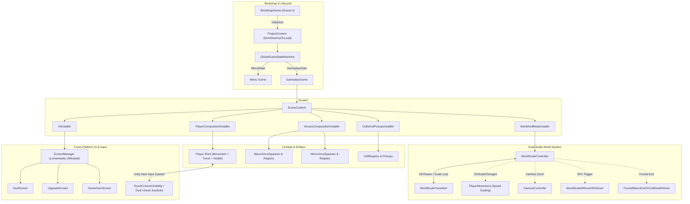

# COVID-19: The Beginning

[](https://unity.com/)
[](https://unity.com/srp/universal-render-pipeline)
[](#2-dependency-injection-zenject)
[](#1-dual-scale-world-transition-system)
[](#-controls--cross-platform-support)

A dual-scale twin-stick action survival game where you pilot an experimental microscopic nanobot defending human host cells against lethal viral mutations. Seamlessly transition between sweeping bloodstream corridors (**Macro World**) and infested cellular interiors (**Micro World**) to eliminate pathogens, cleanse infections, and upgrade nanobot capabilities.

Built on **Unity 6 LTS** utilizing **Zenject / Extenject** for modular dependency injection, **UniTask** for asynchronous flow orchestration, **Universal Render Pipeline (URP)** with post-processing, and native cross-platform support across **Desktop (Windows/macOS/Linux)**, **WebGL**, and **Android** with adaptive dual-stick touch controls.


---

## 🎮 Game Design Document (GDD Overview)


### Core Loop

1. **Macro Bloodstream Patrol**: Pilot the nanobot across bloodstream pathways, intercepting roaming viral carriers (`BigBob`, `Pink Glist`) before they latch onto and penetrate host cells.
2. **Cell Infiltration & Dive**: When a cell comes under attack or suffers viral penetration, navigate into its docking perimeter and activate the dive sequence to enter the **Micro World**.
3. **Cellular Cleansing**: Inside the cell, engage swarms of specialized micro-pathogens (`Cucumber`, `Orange`, `Spiner`) in tight quarters combat while collecting vital nutrient pickups.
4. **Emergency Evacuation**: If cell membrane integrity fails or all internal pathogens are neutralized, transition back into the Macro World to protect adjacent cells.
5. **DNA Biomass & Upgrades**: Slain pathogens release collectible biomass orbs. Accumulating experience triggers mid-combat upgrade cards to customize defensive and offensive loadouts.
6. **Host Survival**: Balance macro perimeter defense with targeted cellular triage to withstand escalating waves and prevent global host collapse.

---

### Dual-Scale Mechanics (Macro vs. Micro)

The defining gameplay pillar is the physical transition between two distinct operational scales:

| Dimension | Macro World (Bloodstream) | Micro World (Cell Interior) |
|---|---|---|
| **World Scale** | `1.0x` (Vast open vascular field) | `0.01x` (Constrained cellular interior) |
| **Player Role** | Interceptor / Patrol Defender | Surgical Exterminator / Cell Stabilizer |
| **Objectives** | Intercept carrier viruses, defend cell borders | Eliminate pathogen clusters, gather vitamins |
| **Primary Threats** | `BigBob` (Heavy Breacher), `Pink Glist` (Fast Drifter) | `OrangeVirus` (Swarmers), `CucumberVirus` (Ranged), `SpinerVirus` (Spikers) |
| **Transition Triggers** | Proximity prompt at infected cell perimeter | Voluntary exit, cell death expulsion, or full cleanse |
| **Camera & Dynamics** | Wide-angle tactical overview, high-speed thrusters | Tight close-up tracking, delicate maneuverability |

---

### Nanobot Upgrades & Progression

Leveling up presents randomized card selections that directly modify player performance metrics via `PlayerStatsService`:

| Upgrade | Stat Key | Effect & Scaling |
|---|---|---|
| **Health** | `MaxHealth` | Increases hull hit points (+25% per rank), repairing damage on purchase. |
| **Armor** | `Armor` | Flat damage reduction per incoming attack, mitigating swarming tick damage. |
| **Damage** | `Damage` | Multiplies turret blaster projectile damage (+20% per rank). |
| **Attack Speed** | `AttackSpeed` | Decreases turret reload cycle duration, increasing fire rate. |
| **Move Speed** | `MoveSpeed` | Increases nanobot engine thruster top velocity and acceleration. |
| **Mobility** | `Mobility` | Enhances angular turning responsiveness and drift stabilization. |

---

### Pathogen Catalog

#### Macro Invaders
- **BigBob (`MacroVirusVariant.BigBob`)**: Heavily armored viral supercluster that tracks toward the nearest host cell, penetrating the membrane to deposit internal infections.
- **Pink Glist (`MacroVirusVariant.PinkGlist`)**: Elongated, high-velocity drift pathogen that harasses the player's nanobot and distracts from cell protection.

#### Micro Invaders
- **Orange Virus (`MicroVirusVariant.Orange`)**: Standard aggressive cellular pathogen that aggressively swarms the nanobot in packs.
- **Cucumber Virus (`MicroVirusVariant.Cucumber`)**: Segmented artillery pathogen that maintains standoff distance while firing projectile bursts.
- **Spiner Virus (`MicroVirusVariant.Spiner`)**: High-speed, spiky rotator that ricochets across the interior cell membrane with high contact damage.

---

## 🏗️ Architecture & Technical Stack

### High-Level Architecture Diagram



---

### Technical Highlights

#### 1. Dual-Scale World Transition System
The seamless shift between bloodstream and cell interior is managed by `WorldScaleController` and `WorldScaleTransition`:
- **Asynchronous Execution via UniTask**: Transitions run asynchronously (`EnterMicroWorldAsync` / `ExitMicroWorldAsync`), coordinating camera zoom, time scale adjustments, and transform scaling without blocking main-thread execution.
- **Dynamic Physics & Speed Scaling**: Nanobot movement physics (`PlayerMovement`) adjust velocity scaling (`1.0f` in Macro, `0.01f` in Micro) so control sensitivity feels consistent across differing world scales.
- **Decoupled Event Drivers**:
  - `WorldScaleWhooshSfxDriver`: Hooks `OnEnteringMicroWorld` and `OnEnteringMacroWorld` to trigger immersive spatial audio whooshes.
  - `ForcedMacroExitOnCellDeathDriver`: Monitors active host cell vitality and cleanly ejects the nanobot back into the Macro World if the host cell perishes during micro combat.
  - `MacroVirusPauseDriver`: Freezes or throttles Macro virus behaviors while the player is inside a cell to prevent unfair background game overs.

#### 2. Dependency Injection (Zenject / Extenject)
The project strictly enforces decoupled architecture through hierarchical Zenject contexts:
- **`ProjectContext`**: Global lifetime container binding core application services (`GlobalGameStateMachine`, `AudioSystem`, `SaveService`, `SceneLoader`).
- **`SceneContext`**: Scoped container for the gameplay session, partitioned into focused composition installers:
  - `WorldAndMetaInstaller`: Binds `WorldScaleController`, camera rigs, and transition contexts.
  - `PlayerCompositionInstaller`: Binds player prefabs, `PlayerStatsService`, projectile pools, and health trackers.
  - `VirusesCompositionInstaller`: Sets up macro/micro virus registries, factory spawners, and targeting providers.
  - `CellsAndPickupsInstaller`: Configures cell tracking drivers and vitamin item pickups.
  - `UiInstaller`: Injects screens into `Lumenwake.UIModule.ScreenManager`.

#### 3. Cross-Platform Input & UI Adaptation
- **Unity New Input System (`Actions.inputactions`)**: Unified input binding supporting Keyboard/Mouse, Gamepads (Xbox/PlayStation/Generic), and Touch screens.
- **Adaptive Touch Controls (`TouchPlatform`, `TouchControlsVisibility`)**: Automatically detects mobile platforms or editor simulation toggles (`ForceTouchPlatformInEditor`). On touch devices:
  - On-screen floating dual virtual joysticks are activated (left stick for vector thrust/steering, right stick for 360-degree turret aiming and auto-fire).
  - HUD elements (health, armor, and XP bars) dynamically re-anchor to the screen header to prevent thumb occlusion.

#### 4. Audio & Presentation System
- **`IAudioSystem` with `SoundData` Assets**: Audio events are decoupled through custom ScriptableObjects with randomized pitch variations, volume curves, and audio source pooling.
- **Particle & Juice Presentation**: Explosions, cell penetrations, vitamin absorption, and laser impacts feature custom particle systems driven by `PlayerParticlesController` and `DamageDeathPresentationConfig`.

---

## 📁 Project Directory Layout

```text
Assets/
├── _Lumenwake/                             # Shared engine architecture & core foundation
│   ├── Art/                                # Shared UI textures, icons, fonts
│   ├── Resources/                          # Global engine configurations
│   ├── Scripts/                            # Core modules: AudioSystem, StateMachine, UIModule
│   ├── Shaders/                            # Custom UI and sprite shaders
│   └── ToolbarShortcuts/                   # Quick editor developer toolbars
│
├── _Project/                               # COVID-19 game-specific implementation
│   ├── Art/                                # Sprites, particle materials, Fredoka fonts
│   ├── Audio/                              # Sound effects, ambient bloodstream audio, music
│   ├── Configurations/                     # Game balance & definition ScriptableObjects
│   │   ├── Audio/                          # SoundData assets (PlayerFire, Hit, Collect, etc.)
│   │   ├── Cells/                          # CellConfig (health, penetration thresholds)
│   │   ├── Combat/                         # DamageDeathPresentationConfig
│   │   ├── Pickups/                        # PickupsConfig (vitamin nutrition values)
│   │   ├── Player/                         # PlayerConfig & UpgradeDefinitions (Damage, Armor, etc.)
│   │   ├── Viruses/                        # MacroVirusConfig, Cucumber, Orange, Spiner configs
│   │   ├── Waves/                          # WaveScalingConfig (difficulty escalations)
│   │   └── WorldScale/                     # WorldScaleConfig (zoom levels, transition timings)
│   ├── Prefabs/                            # Nanobot player, viruses, host cells, UI screens
│   ├── Scenes/
│   │   ├── BootstrapScene.unity            # Entry point (Build Index 0, sets up ProjectContext)
│   │   ├── Menu.unity                      # Main menu screen & audio ambiance
│   │   └── GameplayScene.unity             # Primary dual-scale combat arena
│   ├── Scripts/Game/Runtime/
│   │   ├── Entities/                       # Entity data models and permanent states
│   │   ├── Gateways/                       # Persistence and save/load services
│   │   ├── Mechanics/
│   │   │   ├── AppFlow/                    # GlobalGameStateMachine (MenuState, GameplayState)
│   │   │   ├── Cells/                      # CellController, membrane health, proximity triggers
│   │   │   ├── Combat/                     # Projectiles, damage dealers, health components
│   │   │   ├── Composition/                # Modular Zenject installers and lifecycle drivers
│   │   │   ├── Pickups/                    # Vitamin pickups, nutrient absorption logic
│   │   │   ├── Player/                     # PlayerMovement, PlayerTurret, PlayerStatsService
│   │   │   ├── Viruses/                    # Macro and Micro virus controllers, AI, and spawners
│   │   │   └── WorldScale/                 # WorldScaleController, transitions, scale contexts
│   │   ├── Platform/                       # TouchPlatform detection and mobile layouts
│   │   └── UI/                             # HudScreen, UpgradeScreen, GameOverScreen, MainMenu
│   └── Settings/                           # URP Asset Profiles (UniversalRP, Bloom, Post-Processing)
```

---

## 🚀 Getting Started

### Prerequisites

- **Unity Editor**: `6000.3.10f1` (Unity 6 LTS).
- **Render Pipeline**: Universal Render Pipeline (URP).
- **Target Platforms**:
  - **Standalone**: Windows (DirectX 11/12), macOS (Metal), Linux (Vulkan).
  - **Web**: WebGL 2.0 (WebAssembly).
  - **Mobile**: Android (API level 24+ / ARM64).

### Running in the Editor

1. Clone the repository:
   ```bash
   git clone https://github.com/wismh/covid19.git
   cd covid19/covid19
   ```
2. Open the project folder in **Unity Hub** using **Unity 6000.3.10f1**.
3. Open `Assets/_Project/Scenes/BootstrapScene.unity` (**Scene Index 0**).
4. Enter **Play Mode**. The `BootstrapScene` initializes `ProjectContext`, registers all singleton services, and transitions automatically into the `Menu` scene.
5. Click **Play** to deploy into the bloodstream!

---

## 🎮 Controls & Cross-Platform Support

| Action | Desktop (Keyboard & Mouse) | Gamepad (Xbox / PlayStation) | Android (Touch Controls) |
|---|---|---|---|
| **Nanobot Movement** | `W` / `A` / `S` / `D` or Arrows | **Left Analog Stick** | **Left On-Screen Virtual Joystick** |
| **Turret Aiming** | **Mouse Cursor** | **Right Analog Stick** | **Right On-Screen Virtual Joystick** |
| **Turret Fire** | **Left Mouse Button** (Hold) | **Right Trigger (RT / R2)** | **Right Joystick Deflection** (Auto-fire) |
| **Cell Enter / Dive** | Approach cell + Prompt | Approach cell + Prompt | Approach cell + On-screen prompt |
| **Pause / Menu** | `Escape` | `Start` / `Options` | UI Pause Button |

---

## 📦 Building for Target Platforms

### 1. Standalone Desktop (Windows / macOS / Linux)
1. In Unity, open **File > Build Profiles** (or **Build Settings**).
2. Ensure scenes are included in this exact sequence:
   - `0: Assets/_Project/Scenes/BootstrapScene.unity`
   - `1: Assets/_Project/Scenes/Menu.unity`
   - `2: Assets/_Project/Scenes/GameplayScene.unity`
3. Select **Windows, Mac, Linux** and click **Build**.

### 2. WebGL (Browser)
1. Switch platform to **WebGL** in **Build Profiles**.
2. Under **Player Settings > Publishing Settings**, ensure WebAssembly decompression fallback is configured for your web host.
3. Build the project. Serve the output via HTTP (e.g. `python -m http.server -d build/webgl`) since browsers block local `file://` WebAssembly execution.

### 3. Android
1. Switch platform to **Android**.
2. Verify **Target Architectures** includes `ARM64`.
3. Build the APK or App Bundle (`.aab`). Install on your test device via ADB:
   ```bash
   adb install -r covid19.apk
   ```
   *The game automatically activates on-screen dual joysticks and shifts HUD bars to the top layout when running on touch devices.*
